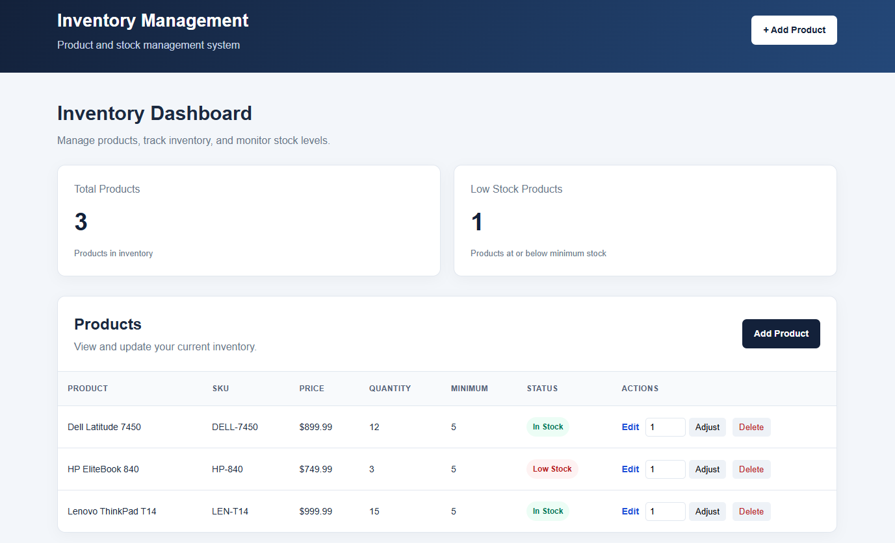
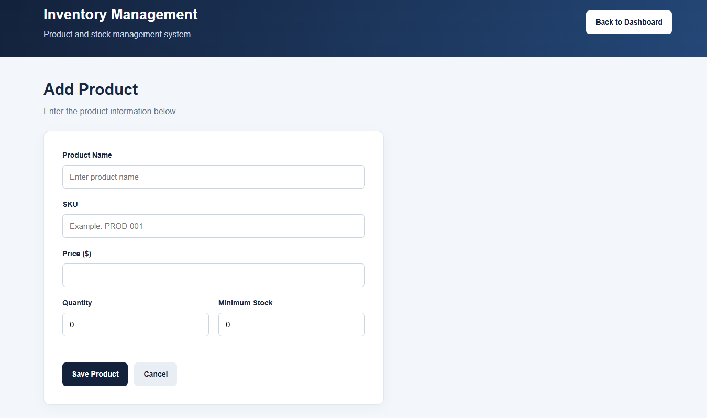

# Inventory Management System

**Java | Spring Boot | Thymeleaf | Spring Data JPA | H2 Database**

Inventory Management System is a full-stack web application I built using Java and Spring Boot. It allows users to manage products, track inventory quantities, adjust stock levels, and identify products that need restocking.

The application uses Thymeleaf for the web interface, Spring Data JPA for database operations, and H2 for persistent inventory storage.

## Application Screenshots

### Inventory Dashboard



### Product Form



## Problem

Keeping track of inventory can become difficult when product information, stock quantities, and minimum inventory levels are managed manually.

I wanted to build an application that makes it easier to manage products, update inventory quantities, and identify when stock is running low.

## Solution

I developed a Spring Boot application that provides a web-based inventory dashboard with product management and stock tracking functionality.

Users can add, edit, and delete products, adjust quantities, and monitor low-stock alerts.

I also implemented validation to prevent duplicate product SKUs and negative inventory quantities.

The application uses a file-based H2 database so inventory information remains saved after restarting the application.

## Features

- **Product Management:** Create, view, update, and delete products.
- **Inventory Tracking:** Track product quantities and minimum stock levels.
- **Stock Adjustments:** Increase or decrease inventory quantities.
- **Low-Stock Alerts:** Identify products at or below their minimum stock threshold.
- **SKU Validation:** Prevent duplicate product identifiers.
- **Input Validation:** Validate product names, prices, and inventory quantities.
- **Negative Stock Prevention:** Reject adjustments that would produce negative quantities.
- **Persistent Storage:** Preserve inventory records between application restarts.
- **Inventory Dashboard:** Display product information and inventory statistics.
- **Responsive Interface:** Adapt the layout to different screen sizes.

## Technologies Used

| Technology | Purpose |
|---|---|
| Java | Application and business logic |
| Spring Boot | Backend application framework |
| Spring MVC | Web controllers and request handling |
| Thymeleaf | Server-rendered HTML interface |
| HTML & CSS | Interface structure and styling |
| Spring Data JPA | Database operations |
| Hibernate | Object-relational mapping |
| H2 Database | Persistent inventory storage |
| Bean Validation | Product input validation |
| JUnit & Mockito | Automated unit testing |
| Maven | Dependency management and builds |
| Git & GitHub | Version control |

## Application Architecture

The application separates its web interface, request handling, business logic, and database operations.

1. **Thymeleaf Templates:** Display the inventory dashboard and product forms.
2. **ProductController:** Processes web requests, form submissions, and redirects.
3. **ProductService:** Handles inventory business logic and validation.
4. **ProductRepository:** Provides database operations through Spring Data JPA.
5. **H2 Database:** Stores product information and inventory quantities.

This structure keeps the business logic separate from the user interface and database access.

## How It Works

1. A user opens the inventory dashboard to view current products.
2. Products can be created or updated through the product form.
3. Spring MVC processes the request and validates the submitted information.
4. The service layer applies business rules, including duplicate SKU checks.
5. Spring Data JPA saves the changes to the H2 database.
6. The dashboard displays the updated products, quantities, and stock statuses.

Stock adjustments are also validated to prevent inventory quantities from becoming negative.

## Getting Started

To run this project locally, you'll need Java 21 or newer.

### 1. Clone the Repository

```bash
git clone https://github.com/sancruz68/inventory-management-system.git
```

### 2. Open the Project Directory

```bash
cd inventory-management-system
```

### 3. Run the Application

On Windows:

```powershell
.\mvnw.cmd spring-boot:run
```

On macOS or Linux:

```bash
./mvnw spring-boot:run
```

The Maven Wrapper downloads the required Maven version if it isn't already available.

### 4. Open the Dashboard

Navigate to:

`http://localhost:8080/`

You can now add products and manage inventory through the web interface.

## Testing

I manually tested the inventory management features and added automated tests using JUnit and Mockito.

### Automated Tests

All eight automated tests passed:

- Spring Boot application context loads successfully.
- Products can be created.
- Duplicate SKUs are rejected.
- Stock quantities can be adjusted.
- Negative stock quantities are prevented.
- Products can be updated.
- Products can be deleted.
- Low-stock conditions are detected.

To run the automated tests on Windows:

```powershell
.\mvnw.cmd test
```

### Manual Testing

I also verified:

- Creating products through the web interface.
- Editing existing product information.
- Deleting products.
- Adjusting inventory quantities.
- Displaying low-stock alerts.
- Rejecting duplicate SKUs.
- Preventing negative inventory quantities.
- Preserving product records after restarting Spring Boot.

## Database Persistence

The application uses a file-based H2 database instead of an in-memory database.

This allows inventory records to remain available after the application is stopped and restarted.

The local database files are excluded from Git using `.gitignore`.

## Current Limitations

- The application is currently intended for local development and demonstration.
- H2 is used for local database storage rather than an external production database.
- User authentication and role-based permissions have not been implemented.
- Inventory adjustments update stock quantities but do not currently maintain a transaction history.

## Future Improvements

- Add product searching and filtering.
- Implement inventory transaction history.
- Add authentication and authorization.
- Expand automated testing.
- Introduce reporting and inventory analytics.
- Explore deployment using AWS.

This project helped me gain more experience working with Spring Boot, database persistence, business logic, input validation, and automated testing.
